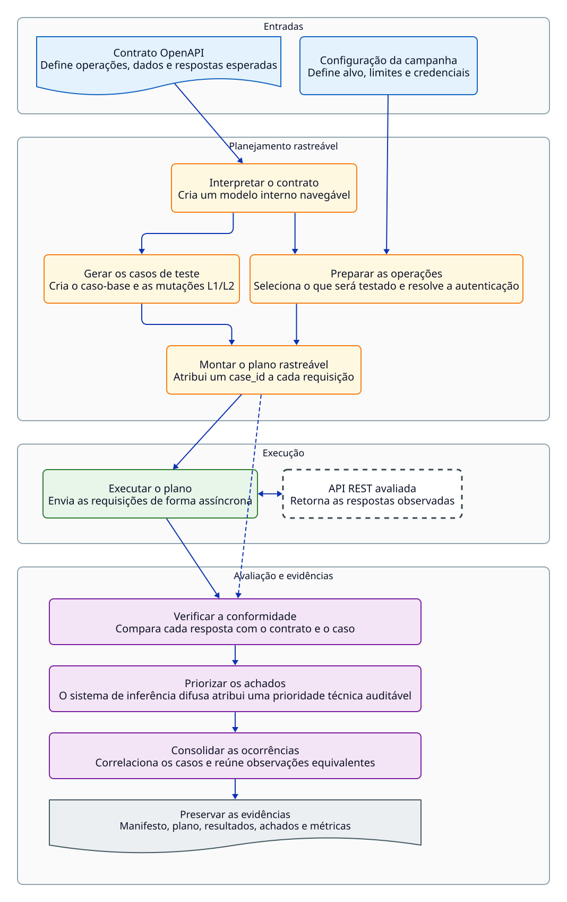
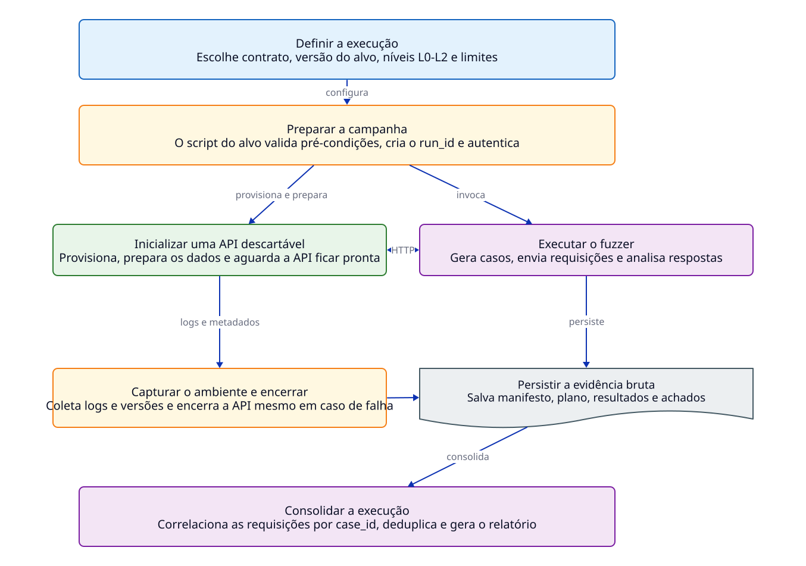

# OpenAPI Contract Fuzzer

Ferramenta de teste *black-box* para APIs REST guiada por contratos OpenAPI. O
projeto interpreta o contrato, gera casos-base e mutações estruturadas, executa
as requisições e registra divergências entre a resposta observada e o
comportamento documentado. Os achados são deduplicados e recebem uma prioridade
técnica auditável por meio de um sistema de inferência fuzzy Mamdani.

O objetivo é apoiar a descoberta e a triagem de inconsistências contratuais,
problemas de robustez e comportamentos de controle de acesso. Um achado não é,
por si só, uma causa raiz, um defeito confirmado ou uma vulnerabilidade.

## Escopo e limitações

- suporte intencional a um subconjunto de OpenAPI usado pelo projeto, sem
  pretensão de implementar integralmente a especificação;
- execução externa à aplicação, sem instrumentação ou cobertura de código;
- geração *stateless* por operação, com suporte parcial a autenticação e sem
  sequenciamento *stateful* geral;
- sem fluxos completos de OAuth2, teste de carga ou confirmação automática de
  impacto de segurança;
- resultados limitados às aplicações, contratos, versões e configurações
  avaliados.

## Arquitetura

O fluxo interno separa interpretação do contrato, geração, execução, análise,
priorização e persistência. O analisador decide se uma resposta deve produzir
um achado; o sistema fuzzy atua somente depois dessa decisão.



As campanhas reproduzíveis usam um runner específico para cada aplicação. O
runner prepara um alvo descartável, aguarda sua disponibilidade, executa o
fuzzer, captura a proveniência do ambiente e encerra a infraestrutura mesmo em
caso de falha. A deduplicação ocorre depois da captura dos dados brutos.



As fontes D2 estão em [`docs/Diagrams/`](docs/Diagrams/). Os SVGs podem ser
regenerados com D2 e o layout ELK:

```bash
d2 --layout elk --pad 32 \
  docs/Diagrams/system-architecture.d2 \
  docs/Diagrams/system-architecture.svg

d2 --layout elk --pad 32 \
  docs/Diagrams/experimental-architecture.d2 \
  docs/Diagrams/experimental-architecture.svg
```

O diretório também contém diagramas específicos da
[rastreabilidade](docs/Diagrams/run-traceability.svg) e da
[priorização fuzzy](docs/Diagrams/fuzzy-prioritization.svg).

## Instalação e verificações locais

Requisitos: Python 3.10 ou superior e `pip`.

```bash
python -m venv .venv
source .venv/bin/activate
pip install -U pip
pip install -e ".[dev]"
```

```bash
pytest -v
```

Os testes verificam o núcleo do projeto sem iniciar as aplicações-alvo. As
campanhas com runners exigem Docker e dependências próprias das aplicações-alvo.

## Execução direta pelo CLI

O CLI pressupõe que a API já esteja disponível. Ele não provisiona nem remove
o alvo:

```bash
python -m fuzzer.main contrato.yaml \
  --base-url http://127.0.0.1:8000 \
  --level 2 \
  --max 20 \
  --max-pairs 10 \
  --concurrency 1 \
  --delay 250 \
  --timeout 10 \
  --all
```

Os níveis controlam a geração:

- `--level 0`: executa somente o caso-base compatível com o contrato;
- `--level 1`: preserva o caso-base e adiciona mutações isoladas;
- `--level 2`: preserva L0/L1 e adiciona pares de mutações compatíveis.

A seleção de operações pode ser feita com `--all`, `--limit`, `--path` e
`--exclude-path`. Sem uma dessas opções, são selecionadas até dez operações.
`--max` limita as mutações isoladas por payload e `--max-pairs` limita os pares
adicionais de L2.

Para autenticação, `--auth arquivo.yaml` injeta credenciais estáticas ou obtidas
por login; `--auto-auth` tenta localizar registro e login no contrato; e
`--auth-probe` testa operações protegidas sem credencial e com credencial
inválida. Cabeçalhos e tokens são redigidos antes da persistência.

## Reprodução por runners

Os runners abaixo administram a infraestrutura local. Eles verificam
pré-condições, iniciam e preparam a aplicação, chamam o runner comum
[`run_experiment.sh`](scripts/experiments/run_experiment.sh), coletam logs e
metadados, encerram o alvo e executam a deduplicação. Não é necessário subir ou
derrubar os contêineres manualmente.

Todos usam `.venv/bin/python` por padrão e aceitam `PYTHON_BIN` para outro
interpretador. Os checkouts externos são procurados em `../mock-projects`, a
menos que as variáveis indicadas abaixo sejam definidas.

| Alvo | Runner | Pré-requisitos e configuração externa |
|---|---|---|
| VAmPI | [`run_vampi_pilot.sh`](scripts/experiments/run_vampi_pilot.sh) | Docker, `curl` e contrato em `$MOCK_ROOT/VAmPI` |
| Spring Petclinic REST | [`run_petclinic_pilot.sh`](scripts/experiments/run_petclinic_pilot.sh) | Docker, `curl` e checkout em `$PETCLINIC_ROOT` |
| OWASP crAPI | [`run_crapi_pilot.sh`](scripts/experiments/run_crapi_pilot.sh) | Docker Compose, `curl` e checkout em `$CRAPI_ROOT` |
| RealWorld/Conduit | [`run_realworld_pilot.sh`](scripts/experiments/run_realworld_pilot.sh) | Docker Compose, `curl`, `jq`, contrato em `$REALWORLD_SPEC_ROOT`, backend em `$REALWORLD_BACKEND_ROOT` e imagem local congelada (abaixo) |
| Meilisearch | [`run_meilisearch_experiment.sh`](scripts/experiments/run_meilisearch_experiment.sh) | Docker, `curl`, `jq`, `shasum` e acesso para baixar o contrato oficial fixado |

Exemplo de uma run L2 identificada, usando a VAmPI:

```bash
EXPERIMENT_ID=TCC-PUBLIC-001 \
LEVEL=2 \
MAX_MUTATIONS=20 \
MAX_PAIRS=10 \
bash scripts/experiments/run_vampi_pilot.sh
```

Os runners das quatro aplicações de desenvolvimento aceitam as mesmas
variáveis de nível e orçamento. O runner do Meilisearch fixa a configuração
confirmatória em L2, 20 mutações isoladas e 10 pares; `REPETITIONS` controla a
quantidade de execuções:

```bash
EXPERIMENT_ID=TCC-PUBLIC-001 \
REPETITIONS=1 \
bash scripts/experiments/run_meilisearch_experiment.sh
```

`RUN_ID` e `OUTPUT_ROOT` permitem identificar a execução e alterar o destino
dos artefatos. `HOST_PORT` também está disponível em VAmPI, Petclinic,
RealWorld e Meilisearch; o runner da crAPI usa a porta 8888 definida por sua
stack. Um diretório de run existente nunca é sobrescrito.

### Imagens congeladas

Petclinic, VAmPI e Meilisearch usam referências por digest. Na crAPI,
[`crapi-images.yaml`](scripts/experiments/crapi-images.yaml) complementa o
Compose original apenas com as nove imagens usadas pelo runner e a plataforma
`linux/amd64` do Mongo. O serviço opcional de gateway do Compose original não
é iniciado pelo runner. Os digests preservam as imagens das verificações locais;
não representam atualização das aplicações.

O RealWorld reutiliza a imagem **arm64** da auditoria de 04/09/2026, construída
do backend `04ef47ced437ee8795a13bdcbc2eff2be19e33bd`:
`sha256:3bb0bcd5f84c18a7ee6c71df24534cc6c0dbc7e36a202137eefc25b0d2c4878a`.
O runner exige essa imagem local e esse commit do checkout, fixa o PostgreSQL
por digest e não executa build. As imagens efetivas são registradas em
`data/target_images.json` em cada campanha.

A imagem pode ser preservada e restaurada sem uma nova resolução de dependências:

```bash
mkdir -p output/frozen-images
# Executar uma vez, sem sobrescrever um arquivo já preservado.
docker image save --output output/frozen-images/realworld-3bb0bcd5f84c.tar \
  sha256:3bb0bcd5f84c18a7ee6c71df24534cc6c0dbc7e36a202137eefc25b0d2c4878a
docker image load --input output/frozen-images/realworld-3bb0bcd5f84c.tar
```

Esse arquivo é local e ignorado pelo Git; não acompanha o clone do repositório.
Sem ele ou a imagem já carregada, a execução do RealWorld é bloqueada. Um build
novo pode resolver dependências diferentes e não substitui silenciosamente a
imagem congelada. Disponibilizar o arquivo para reprodução externa e garantir
um rebuild idêntico são questões distintas; este procedimento garante somente
a reutilização do mesmo executável nas campanhas locais.

## Artefatos e pós-processamento

Cada execução cria `output/experiments/<experimento>/<alvo>/<run-id>/` quando
iniciada por um runner, ou `output/<run-id>/` na execução direta padrão. A
estrutura principal é:

```text
<run-id>/
├── run_manifest.json
├── data/
│   ├── execution_plan.json
│   ├── results.json
│   └── ... proveniência específica do alvo
└── analysis/
    ├── analysis_findings.json
    ├── analysis_report.md
    ├── findings_unique.json
    ├── metrics.json
    └── deduplication_report.md
```

O manifesto registra configuração, revisão do código, hashes, horários,
contagens e estado da execução. `case_id` correlaciona plano, requisição,
resposta e achado. A deduplicação usa uma assinatura operacional *black-box*
para reunir observações equivalentes sem tratá-las como a mesma causa raiz.

O CLI deduplica automaticamente uma execução concluída. Os runners usam
`--no-deduplicate`, capturam primeiro a proveniência do alvo e chamam depois o
pós-processador. Uma run também pode ser processada novamente sem executar a
API:

```bash
PYTHONPATH=src python scripts/experiments/deduplicate_run.py \
  output/experiments/<experimento>/<alvo>/<run-id>
```

## Priorização fuzzy

O modelo atual (`mamdani-behavior-evidence-access-v3`) recebe três antecedentes:

- contradição entre o comportamento observado e o contrato;
- força da evidência disponível para o achado;
- exposição observada em testes de controle de acesso.

Seis regras Mamdani produzem um score entre 0 e 1, convertido nas faixas `LOW`,
`MEDIUM` e `HIGH`. Cada achado preserva os valores de entrada, graus de
pertinência, regras ativadas e eventual uso do fallback, permitindo auditar a
classificação.

O score expressa **prioridade técnica para triagem**. Ele não estima
explorabilidade, impacto real ou gravidade de segurança e não substitui a
análise humana do achado. O desenho do modelo está resumido no
[diagrama de priorização](docs/Diagrams/fuzzy-prioritization.svg).

## Estado experimental

A [amostra pública versionada](experiments/tcc-2026/public/README.md) contém
uma run L2 de cada uma das cinco APIs, com 1.435 requisições concluídas. Ela
permite inspecionar o pipeline, mas não sustenta métricas entre cinco campanhas.

Os [pilotos](experiments/tcc-2026/pilot.yaml) e a confirmação histórica do
Meilisearch tiveram papéis próprios no desenvolvimento e na avaliação do FIS.
A coleta final posterior executou 25 campanhas novas, cinco por API. Suas runs
permanecem em `output/experiments/TCC-FINAL-001/`, ignorado pelo Git; o pacote
público dessa coleta ainda não foi versionado. O
[plano de fechamento](experiments/tcc-2026/FINAL-PACKAGE-PLAN.md) define a
refatoração do analisador, a validação e a publicação de um único pacote final.

## Estrutura do código

- `src/fuzzer/parser/`: interpretação do contrato OpenAPI;
- `src/fuzzer/generator/` e `src/fuzzer/mutator/`: casos-base e mutações;
- `src/fuzzer/orchestrator/`: autenticação, plano e coordenação da execução;
- `src/fuzzer/executor/`: cliente HTTP assíncrono e resultados brutos;
- `src/fuzzer/analysis/`: detecção, priorização fuzzy e deduplicação;
- `src/fuzzer/utils/`: manifesto, persistência, redação e utilitários;
- `scripts/experiments/`: runners e pós-processamento experimental;
- `experiments/tcc-2026/`: protocolos documentais e amostra pública;
- `docs/`: artigo e fontes dos diagramas.
